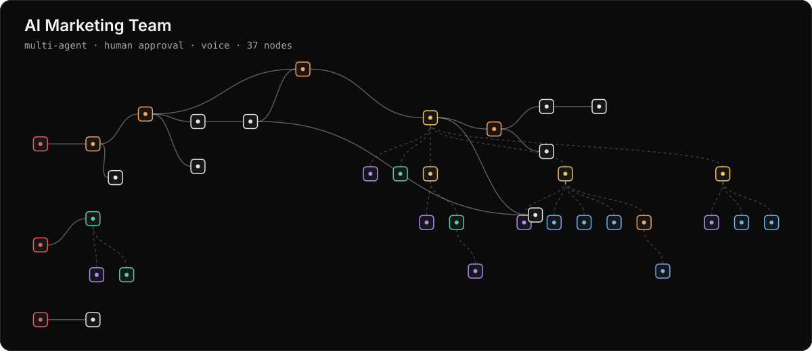
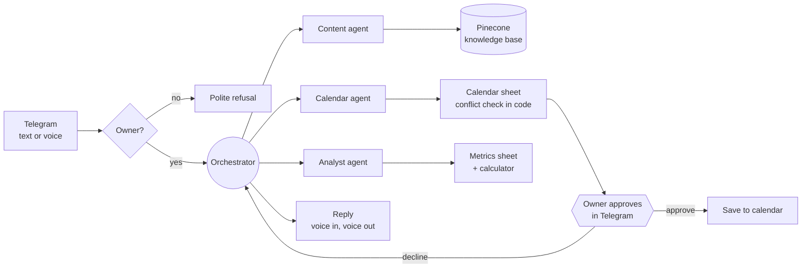

  

> **Demo · fictional café, sample data.**

A café owner sends one message, typed or spoken. An Orchestrator works out what they need, hands it to Content, Calendar or Analyst agents, reviews the results and sends back one answer.

In the [explorer](https://sfditala.github.io/ai-marketing-team/) you can press play and follow a message through the workflow, node by node. Click any of the 37 nodes to read its real prompt, code and connections.

## Who gets to decide?

In this system, the model doesn't decide everything. Pick an action to see who controls it.

| Situation | Outcome |
|---|---|
| Write the caption | **AI.** The Content Agent writes it in the brand's voice and follows each platform's rules. |
| Quote a price | **Knowledge base.** Prices can only come from RAG. If a fact is still missing after two searches, the agent says so. |
| Save a post to the calendar | **The owner.** The workflow pauses and sends Approve and Decline buttons. Nothing is saved without Approve. |
| Spot a calendar clash | **Code.** A code tool rejects past dates and taken slots. The model can't overrule it. |
| Calculate engagement | **Calculator tool.** Every figure goes through the calculator, and the answer names the posts it used. |
| Let a stranger in | **Code.** The allowlist runs before any model, so a stranger gets a refusal and costs nothing. |

[▶ Try this in the explorer](https://sfditala.github.io/ai-marketing-team/)

## The workflow

## The problem

Small café owners know they should post every week, but they rarely have time to write captions, keep a calendar or check which posts brought customers in. Generic AI tools don't know the menu or the offers, so they make things up.

## How it was built

**Stack:** n8n · OpenAI gpt-5-mini · Pinecone · Gemini Embeddings · Google Sheets · ElevenLabs · Telegram Bot API

<b>Design decisions</b>

- **The model cannot skip the owner's approval.** Saving to the calendar sits behind a Telegram approve or decline node, so a prompt can't talk its way past it.
- **Orchestrator, not a router.** It can run two tasks from one message, such as writing a post and scheduling it, and review each result before replying.
- **Code decides what must be exact.** Reply language, the owner allowlist and calendar conflicts are computed in code. Models handle understanding and writing.
- **Prices come only from RAG.** If a fact isn't in the knowledge base after two searches, the agent says it's missing.

<b>What broke, and the fix</b>

| What went wrong | The fix |
|---|---|
| The model answered English questions in Arabic, because the knowledge base is Arabic. | Reply language is now computed in code and passed to every agent. |
| One long search returned platform rules instead of a product's price. | The Content Agent runs short, separate searches for each topic. |
| A technical error was reported to the owner as "you declined". | The Calendar Agent now separates approved, declined and error. |

## Run it yourself

1. In n8n, go to **Workflows → Import from File** and choose [`workflow.json`](workflow.json).
2. Connect Telegram, OpenAI, Pinecone, Gemini, Google Sheets and ElevenLabs credentials.
3. Create a Pinecone index whose dimensions match your Gemini embedding model.
4. Create a sheet with three tabs: content_calendar, best_times and campaign_metrics.
5. Replace `YOUR_TELEGRAM_USER_ID`, `YOUR_TELEGRAM_CHAT_ID` and `YOUR_GOOGLE_SHEET_ID`.
6. Upload your knowledge files through the form, then publish.

This export contains no credentials or webhook IDs. Personal IDs are replaced with placeholders, and [a check](scripts/check-clean.mjs) runs on every push.

## العربية

فريق تسويق بالذكاء الاصطناعي داخل محادثة تيليجرام: Orchestrator وثلاثة Agents، وخطوة موافقة ما بيقدر الموديل يتخطاها. المشروع تجريبي على مقهى خيالي وببيانات تجريبية.

---

Built by <a href="https://portfolio-mauve-seven-44.vercel.app/"><b>Tala Safadi</b></a>, AI Engineer · <a href="https://www.linkedin.com/in/talasfdi">LinkedIn</a> More systems: [Clinic AI Receptionist](https://github.com/Sfditala/clinic-ai-receptionist) · [Telegram Personal Assistant](https://github.com/Sfditala/telegram-personal-assistant)

